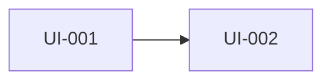

# UI 레이아웃 — [화면 묶음 이름]

파일 위치: docs/design/ui/<묶음>-layout.md
레이아웃 그림은 아래 중 편한 방법으로 만든다. 그림 파일은 docs/design/ui/images/에 둔다.
- 손그림·PPT·포토샵 이미지를 넣고 Claude가 요소 표를 정리
- Claude가 HTML 와이어프레임을 만들어 브라우저로 확인
- 간단한 화면은 아래처럼 텍스트 박스 그림

## 수정 이력
| 버전 | 날짜 | 변경 내용 | 작성 |
|---|---|---|---|

## 1. 화면 목록
| 화면 ID | 화면 이름 | 종류 (전체화면/팝업/토스트) | 진입 경로 | 관련 기능 ID |
|---|---|---|---|---|
| UI-001 | | | | F-001 |

## 2. 화면 흐름


## 3. 화면 상세

### UI-001 [화면 이름]
**레이아웃**
```
+--------------------------------+
| [뒤로]     상점        [재화]  |  ← 상단바
+--------------------------------+
| [탭1] [탭2] [탭3]               |
+--------------------------------+
| [상품] [상품] [상품]            |  ← 스크롤 리스트
| [상품] [상품] [상품]            |
+--------------------------------+
|           [구매]               |
+--------------------------------+
```
(또는 이미지: images/UI-001.png)

**구성 요소**
| 번호 | 요소 | 종류 (버튼/텍스트/리스트/이미지) | 데이터·문구 키 | 동작 | 공통 부품 |
|---|---|---|---|---|---|
| 1 | 뒤로 | 버튼 | | 이전 화면 | BackButton |

**상태별 표시**
| 상태 | 표시 |
|---|---|
| 로딩 | |
| 빈 데이터 | |
| 오류 | |
| 비활성 (조건 미충족) | |

**플랫폼 고려**
- 안전 영역(노치), 기기 뒤로가기, 가로·세로, 해상도 범위:
